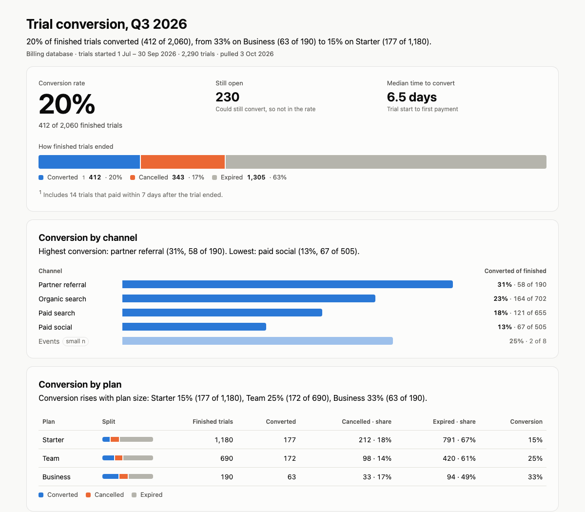

# present-results

An agent skill for pages that show numbers. It teaches Claude, Codex and other coding agents to build reports, dashboards and analysis pages so the reader gets the answer at a glance and can trust it.



Without guidance, agents tend to build the same results page every time: an intro paragraph, a row of icon cards, a pie chart, a rainbow of colors, "Key takeaways" and percentages without counts. This skill replaces that with one rule and a set of defaults, each backed by research or a published standard.

## The rule: content, grounding, meaning

A results page answers one question for one reader. Only three things go on it:

| Layer | What it is |
|---|---|
| **Content** | the data that answers the question: numbers, charts, tables |
| **Grounding** | what makes it trustworthy and readable: source, period, pull date, base (n), excluded cases, definitions, caveats |
| **Meaning** | what the data says, in one sentence with its number |

Every element must pass a deletion test: *without it, could the reader still get the answer, trust it and read it correctly?* If so, it goes. Causes and recommendations appear only when the reader asked for them, marked as interpretation and tied to a number on the page.

## The ten rules

1. **Lead with the answer.** The page and every section open with one sentence that gives the number and its base.
2. **Every rate shows its base:** `20%` *and* `412 of 2,060 finished trials`.
3. **Use length and position for numbers.** Bars on a zero baseline. No pies, donuts, gauges, 3D or dual axes.
4. **Color marks states, not groups.** States are outcomes such as converted or cancelled. Groups such as plan or channel are rows and labels, and each color means the same thing everywhere on the page.
5. **Never use color alone.** A label or count sits beside every colored mark.
6. **Same thing, same way:** one component, one scale, one word per idea.
7. **Overview first.** The answer fits the first screen, and details sit below it.
8. **Text is ink.** At least 4.5:1 contrast, and never on a solid colored fill.
9. **Every number is traceable:** source, period, pull date, definitions, caveats.
10. **No bullshit.** If it isn't content, grounding or meaning, delete it.

The skill also covers:
- small groups, which stay visible but never lead a ranking or set a chart's scale
- gaps that chance can explain ("close calls")
- a page skeleton and a table for choosing chart types
- light and dark color tokens, number formats and component specs
- sentence templates for findings and a ship checklist

## What the rules are based on

Each rule serves a stated goal. The core rules rest on perception experiments and published standards. Numeric defaults such as "fewer than 10 cases is small n" are marked † in the skill as house choices.

| Rule | Evidence | Why |
|---|---|---|
| Lead with the answer | [NN/g, F-shaped reading](https://www.nngroup.com/articles/f-shaped-pattern-reading-web-content/); [Borkin et al. 2016](https://doi.org/10.1109/TVCG.2015.2467732); [Kong et al. 2018](https://zcliu.cs.umd.edu/vistitles/CHI18-VisTitles.pdf) | Readers scan the top and the titles, and the title shapes what they take away. So a finding line states and compares, and never grades. |
| Length and position, no pies | [Cleveland & McGill 1984](https://doi.org/10.1080/01621459.1984.10478080), replicated by [Heer & Bostock 2010](https://doi.org/10.1145/1753326.1753357); [NN/g](https://www.nngroup.com/articles/dashboards-preattentive/) | People compare positions and lengths more precisely than angles, areas or shading. Pies can do well for a single share of a whole; the research file says where and why the skill still uses bars. |
| Color has one job | NN/g; [UK Government Analysis Function](https://analysisfunction.civilservice.gov.uk/policy-store/data-visualisation-colours-in-charts/); [NEI](https://www.nei.nih.gov/learn-about-eye-health/eye-conditions-and-diseases/color-blindness) | Color grabs attention before reading starts, is a weak channel for amounts, and about 1 in 12 men can't tell some colors apart. |
| Every rate shows its base | Small-group arithmetic; metric definitions from GitHub, DX and Google Ads | 100% of 2 looks better than 60% of 50, and the same metric name hides different formulas in different tools. |
| Overview first | [Shneiderman 1996](https://drum.lib.umd.edu/handle/1903/5784); Few, *Information Dashboard Design*; [AWS Cloudscape](https://cloudscape.design/patterns/general/service-dashboard/static-dashboard/) | A reader who stops after the first screen should still have the answer. |
| No decoration | Tufte, data-ink ratio; [UK Analysis Function](https://analysisfunction.civilservice.gov.uk/policy-store/data-visualisation-charts/) | Every element that isn't data competes with the data for attention. |
| Contrast | [WCAG 2.2](https://www.w3.org/WAI/WCAG22/Understanding/contrast-minimum.html) | Below 4.5:1, part of the audience can't read small text. |

[`references/research.md`](references/research.md) has:
- the full reasoning for each rule
- the evidence that pushes back, such as studies where pies hold their own
- other ways to reach each goal when a rule doesn't fit
- the source list, with notes on which sources were read in full

## What's in the repo

| File | Purpose |
|---|---|
| [`SKILL.md`](SKILL.md) | the manual the agent follows |
| [`references/research.md`](references/research.md) | goal, evidence, counter-evidence and alternatives for each rule |
| [`assets/starter.html`](assets/starter.html) | a self-contained example page to copy from: light and dark mode, works at phone width; the data is made up |
| [`docs/`](docs/) | screenshots of the starter page ([dark mode](docs/starter-dark.png)) |

## Install

**Claude Code.** Install it as a personal skill, available in every project:

```bash
git clone https://github.com/Jonathanhaber/present-results ~/.claude/skills/present-results
```

For a single project, clone it into `<project>/.claude/skills/present-results` instead.

**Codex, Gemini CLI and other agents that read Agent Skills.** Clone it into the agent's skills folder, for example `~/.agents/skills/present-results`.

**Claude.ai.** Upload a ZIP whose top folder is named `present-results` under Settings → Capabilities → Skills:

```bash
git clone https://github.com/Jonathanhaber/present-results
zip -r present-results.zip present-results -x 'present-results/.git/*' 'present-results/docs/*'
```

The agent loads the skill on its own when you ask for a report, dashboard or results page. You can also name it: "Use present-results to turn this CSV into a results page."

## Works with

The skill stands on its own. If your agent also has these skills, it uses them for what this one doesn't cover:
- `dataviz`: chart mechanics and palette validation
- `artifact-design`: the Claude artifact page contract

Where they conflict, present-results wins. A project's own design manual wins over present-results.

## License

MIT
